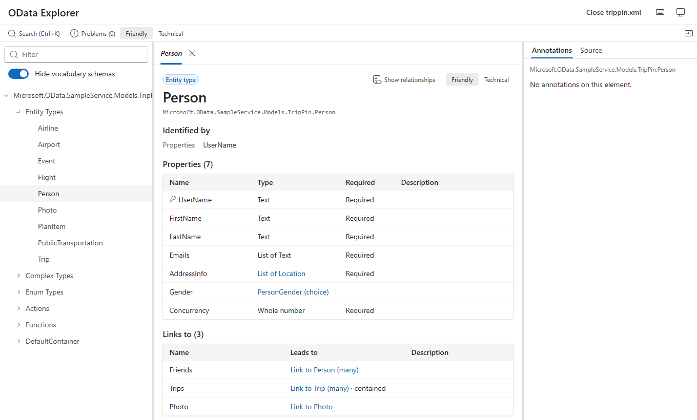
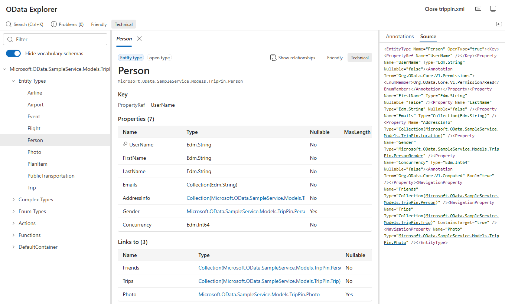
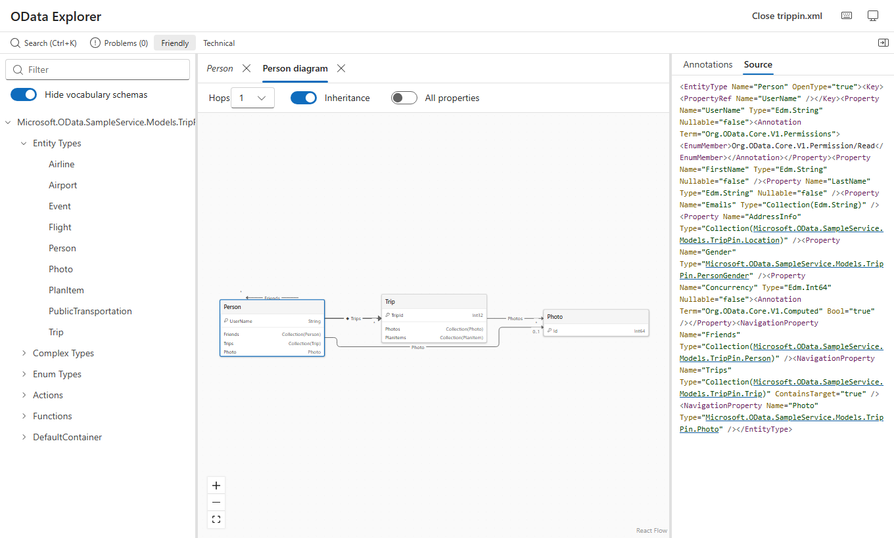
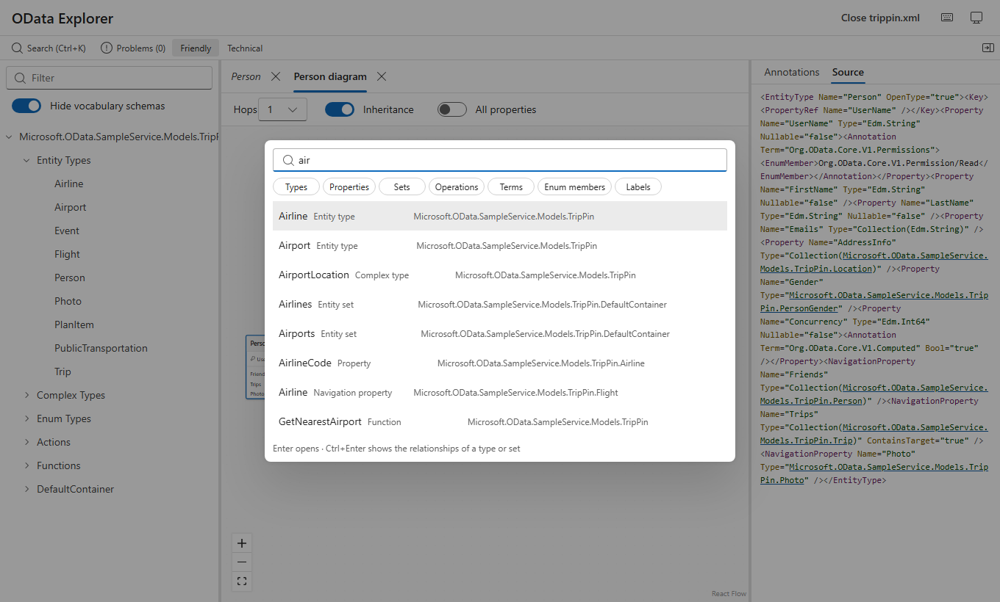

# OData Explorer

A browser app for exploring OData v4 `$metadata` documents: entity types, relationships, annotations
and operations, in friendly or technical detail. Everything runs client-side, so metadata never leaves
the browser.



Version 1.0. The [plan](docs/PLAN.md) explains the design and the [roadmap](docs/roadmap/README.md) how
it was built; [PERF.md](docs/PERF.md) has the performance numbers.

## Features

- **Open a document** by dropping or picking a file: OData v4 `$metadata` as CSDL XML (4.0, 4.01) or
  CSDL JSON. OData v2/v3 documents are rejected with a clear message. Problems in a document (unresolved
  references, duplicate IDs) are listed and everything parseable still renders.
- **Browse everything the document defines:** a navigator tree per schema (entity types, complex types,
  enums, type definitions, terms, actions, functions) and the entity container (sets, singletons, imports),
  with a filter box and a switch that hides the bundled vocabulary schemas.
- **Friendly or technical.** One toggle in the toolbar, and one per view: friendly pages say "List of Text"
  and "Required", technical pages say `Collection(Edm.String)` and `Nullable="false"`.
- **A page for every kind of element:** types with inherited members and their key, entity sets with their
  bindings and capabilities, operations with all their overloads, enums, and a schema overview.
- **Annotations, read as sentences.** Terms from the standard OASIS vocabularies (Core, Capabilities,
  Measures, Validation, ...) are bundled, so `Org.OData.Core.V1.Computed` is shown as "Computed" with its
  description, and capability annotations become badges.
- **Source view.** The exact XML or JSON of the selected element; qualified names in it are links.
- **Relationship diagram.** The neighborhood of a type, 1 to 3 hops, with inheritance, laid out in a
  background worker. Click a node to open its type.
- **Search with `Ctrl+K`** across every symbol, with filters by kind.
- **Tabs** like an editor: a single click previews, a double click keeps. The tabs, the active one and the
  recent files are remembered in this browser, and every page has a URL you can paste.
- **Large documents.** A 4 MB Microsoft Graph document loads in about 0.3 s of parsing, off the main
  thread, with no UI freeze over 100 ms.
- **Private.** There is no server: the metadata never leaves the browser.
- Light, dark and system themes. Every feature works from the [keyboard](#keyboard).

| | |
|---|---|
|  |  |
|  | |

## Keyboard

Every feature works without a mouse. Press `?` in the app for this list.

| Where | Keys | Action |
|---|---|---|
| Anywhere | `Ctrl+K` | Search every symbol of the model |
| Anywhere | `?` | Show the shortcuts |
| Anywhere | `Tab` / `Shift+Tab` | Move between the toolbar, navigator, tabs and views |
| Search | `Up` / `Down`, `PageUp` / `PageDown` | Move through the results |
| Search | `Enter` | Open the result |
| Search | `Ctrl+Enter` | Show the relationships of a type or set |
| Search | `Esc` | Close the search |
| Navigator | `Up` / `Down` | Move between elements |
| Navigator | `Right` / `Left` | Expand or collapse a group; move into or out of it |
| Navigator | `Enter` | Open the element |
| Tabs | `Left` / `Right` | Move between open tabs |
| Tabs | `Enter` | Keep a preview tab open |
| Tabs | `Delete` | Close the tab |
| Tabs | `Menu` key / `Shift+F10` | Open the tab menu |
| Diagram | `Tab` | Move between the nodes |
| Diagram | `Enter` / `Shift+Enter` | Open the type of the focused node / open it and keep the tab |

When a search closes, the focus goes to the tab it opened (or back to where it was, on `Esc`).

## Setup

Requires Node.js 20.19+ or 22.12+.

```
npm install
npx playwright install chromium   # browser for the end-to-end tests
```

## Develop

```
npm run dev      # dev server with hot reload on http://localhost:5173
npm run lint     # ESLint, then a Prettier check
npm run format   # apply Prettier formatting
```

## Test

```
npm test         # unit and component tests (Vitest)
npm run e2e      # end-to-end tests (Playwright) against the production build
npm run fetch:perf && npm run bench   # throughput on the Microsoft Graph documents
```

The Graph documents are downloaded into the gitignored `fixtures/large/`; without them, the Graph
end-to-end tests skip themselves.

`npm run e2e` builds the app and serves it from the `/sub/` path, the way a static host might.

## Build

```
npm run build    # type-check, then bundle into dist/
npm run preview  # serve dist/ on http://localhost:4173
```

## Deploy

`npm run build` produces a static bundle in `dist/` with no backend. Copy the contents of `dist/` to any
static web host (GitHub Pages, Azure Static Web Apps, S3, nginx, ...). Asset URLs are relative
(`base: './'` in `vite.config.ts`), so the app works from the domain root or from any subpath. The end-to-end
tests serve the build from `/sub/` to prove it.

The app needs no server-side routing: its URLs use the hash (`#/d/<file>/<kind>/<id>`), so any host that
serves `index.html` works. Files stay in the visitor's browser (IndexedDB); nothing is uploaded.
